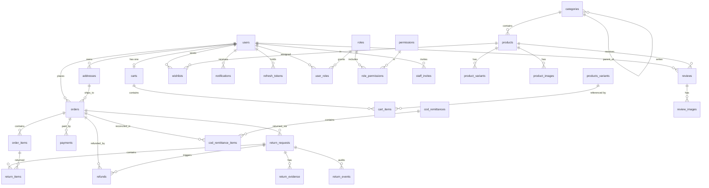

# Database Design

> PostgreSQL · SQLModel (SQLAlchemy 2 + Pydantic) · Alembic migrations
> Source of truth: `backend/app/models/**` and `backend/alembic/versions/**`

---

## 1. Overview

| Property | Value |
|---|---|
| Engine | PostgreSQL (`psycopg2`); SQLite accepted in tests |
| Models | 27 Python modules |
| Tables | **40** |
| Migrations | **61** revisions, single head `b2c3d4e5f6a7` |
| Primary keys | UUID v4 (except `store_settings.id = 1`, `cart_merge_receipts`, `chat_rate_limits.key`) |
| Money | `NUMERIC` via Python `Decimal` — never floats |
| Timestamps | `TIMESTAMP WITH TIME ZONE`, UTC |
| Naming | `snake_case` tables (plural), `snake_case` columns |

Connection configuration (`app/db/database.py`):

```python
engine = create_engine(settings.DATABASE_URL, pool_pre_ping=True)
```

`pool_pre_ping` drops dead connections instead of surfacing them as request
errors — important behind managed Postgres/pgbouncer.

---

## 2. Entity-Relationship Overview



> Note: `products_variants` above is shorthand — the real table is
> `product_variants`.

---

## 3. Table Catalog

### 3.1 Identity and access

#### `users`

| Column | Type | Notes |
|---|---|---|
| `id` | UUID | PK |
| `email` | str | unique, indexed, not null |
| `username` | str | unique, indexed, not null |
| `password_hash` | str NULL | null for Google-only accounts |
| `role` | enum | `customer/staff/manager/admin` (legacy), indexed |
| `full_name`, `phone` | str NULL | |
| `is_active` | bool | soft ban |
| `token_version` | int | bump to revoke all access tokens |
| `email_verified` | bool | |
| `google_id` | str NULL | unique, indexed |
| `auth_provider` | str | `email` or `google` |
| `push_notifications_enabled`, `email_notifications_enabled` | bool | prefs |
| `created_at`, `updated_at` | timestamptz | |

#### `permissions`

| Column | Type | Notes |
|---|---|---|
| `id` | UUID | PK |
| `key` | str | unique, indexed (`orders.view`) |
| `label`, `module`, `description` | str | UI catalog |
| `created_at` | timestamptz | |

#### `roles`

| Column | Type | Notes |
|---|---|---|
| `id` | UUID | PK |
| `tenant_id` | UUID NULL | reserved for multi-tenant |
| `name` | str | display name |
| `slug` | str | unique, indexed |
| `description` | str NULL | |
| `is_system` | bool | system roles immutable |
| `max_refund_amount` | Decimal NULL | `NULL` = unlimited, `0` = never alone |
| `created_by` | UUID → users | |
| `created_at`, `updated_at` | timestamptz | |

#### `role_permissions` (join)

`role_id` + `permission_id` composite PK, `granted_at`. Both FKs indexed.

#### `user_roles` (join)

`user_id` + `role_id` composite PK, `assigned_at`, `assigned_by → users`.

#### `staff_invites`

| Column | Type | Notes |
|---|---|---|
| `id` | UUID | PK |
| `email` | str | indexed |
| `role_slugs` | JSON array | roles granted on accept |
| `invited_by` | UUID → users | |
| `token_hash` | str | unique, indexed — raw token never stored |
| `status` | str | indexed (`pending/accepted/revoked/expired`) |
| `expires_at`, `accepted_at`, `created_at` | timestamptz | |

#### `refresh_tokens`

| Column | Type | Notes |
|---|---|---|
| `id` | UUID | PK |
| `user_id` | UUID → users | indexed |
| `token_hash` | str | unique, indexed |
| `expires_at` | timestamptz | |
| `scope` | str | indexed — `admin` / `storefront` |
| `revoked` | bool | |
| `session_id` | UUID | indexed; shared by a login's token family |
| `created_at` | timestamptz | |

#### `password_reset_tokens`

`token` (unique, indexed), `user_id`, `expires_at`, `used`, `created_at`.

#### `otps`

`email` (indexed), `otp_code` (hashed), `purpose` (`signup` / `admin_login`),
`expires_at`, `is_used`, `attempts`, `created_at`.

#### `admin_audit_log`

| Column | Type | Notes |
|---|---|---|
| `id` | UUID | PK |
| `actor_id` | UUID NULL → users | indexed |
| `action` | str | indexed (`refund.approve`, `settings.update`) |
| `entity` | str | indexed (`order`, `role`, `store_settings`) |
| `entity_id` | str NULL | indexed |
| `before`, `after` | JSON NULL | full snapshots |
| `ip_address` | str NULL | |
| `created_at` | timestamptz | indexed |

### 3.2 Catalog

#### `categories`

`id`, `name` (indexed), `slug` (unique, indexed), `parent_id → categories`
(self-referencing, indexed), `image_url`, `image_public_id`, `is_active`
(indexed), `sort_order`, `created_at`.

#### `products`

| Column | Type | Notes |
|---|---|---|
| `id` | UUID | PK |
| `name` | str | indexed |
| `slug` | str | unique, indexed |
| `description` | str NULL | |
| `category_id` | UUID NULL → categories | indexed |
| `price` | Decimal | base price |
| `compare_at_price` | Decimal NULL | strike-through price |
| `is_active` | bool | indexed; soft delete |
| `created_by` | UUID NULL → users | |
| `created_at`, `updated_at` | timestamptz | |

#### `product_variants`

`id`, `product_id → products` (indexed), `sku` (unique, indexed),
`attributes` (JSON: `{"size":"M","color":"Black"}`),
`price_override` (Decimal NULL), `stock` (int), `created_at`.

Stock lives here, not on `products`. Effective price =
`COALESCE(price_override, product.price)`.

#### `product_images`

`product_id → products` (indexed), `url`, `secure_url`,
`cloudinary_public_id` (indexed), `alt_text`, `sort_order`, `created_at`.

#### `reviews`

`product_id` (indexed), `user_id` (indexed), `order_id` (indexed, nullable),
`rating` (1–5), `title`, `comment`, `is_verified_purchase`, `is_hidden`
(indexed), `created_at`, `updated_at`.

#### `review_images`

`review_id → reviews` (indexed), `secure_url`, `cloudinary_public_id`
(unique), `filename`, `sort_order`, `created_at`.

#### `wishlists`

`user_id` (indexed), `product_id` (indexed), `created_at`. App-level uniqueness
per (user, product).

### 3.3 Cart

#### `carts`

| Column | Type | Notes |
|---|---|---|
| `id` | UUID | PK |
| `user_id` | UUID NULL → users | **unique**, indexed — one cart per user |
| `session_id` | str NULL | indexed — guest cart identity |
| `coupon_code` | str NULL | applied manual coupon |
| `created_at`, `updated_at` | timestamptz | |

#### `cart_items`

`cart_id → carts` (indexed), `variant_id → product_variants` (indexed),
`quantity`, `price_at_add` (Decimal), `created_at`.

`price_at_add` is informational; pricing is recomputed at checkout.

#### `cart_merge_receipts`

Composite identity: `cart_id` (PK, FK → carts, `ON DELETE CASCADE`) +
`merge_key` (PK), plus `variant_id`, `quantity`.

Purpose: make guest→user cart replay idempotent. The same `merge_key` cannot
apply twice.

### 3.4 Orders

#### `orders` — the widest table

| Group | Columns |
|---|---|
| Identity | `id` (PK), `order_number` (unique, indexed), `user_id` (indexed) |
| Addresses | `shipping_address_id → addresses`, `billing_address_id → addresses` |
| Snapshots | `customer_snapshot`, `shipping_snapshot`, `billing_snapshot` (JSON) |
| Money | `subtotal`, `discount_total`, `tax_total`, `shipping_total`, `grand_total`, `cod_fee`, `refund_amount`, `restocking_fee` (all Decimal) |
| Coupon | `coupon_code` |
| Payment | `payment_method`, `payment_status`, `refund_id`, `refund_reason`, `refunded_at` |
| COD | `cod_remitted_amount`, `cod_remittance_status` (indexed), `cod_remitted_at` |
| Lifecycle | `status` (enum), `cancellation_reason`, `cancelled_at`, `placed_at`, `updated_at`, `shipped_at`, `delivered_at` |
| Shipping | `shiprocket_order_id`, `shiprocket_shipment_id`, `awb_code` (all indexed), `courier_name`, `courier_id`, `courier_etd`, `expected_delivery_date`, `shipping_label_url`, `manifest_url`, `shipment_status`, `pickup_scheduled_date`, `tracking_data` (JSON) |
| Flags | `placed_by_staff` (indexed), `rto_stock_restored` (indexed), `stock_released` |

Snapshots are the reason catalog edits never rewrite order history: name, SKU,
attributes, unit price and addresses are frozen at placement.

#### `order_items`

`order_id → orders` (indexed), `variant_id → product_variants` (indexed),
`product_name`, `variant_sku`, `variant_attributes` (JSON), `quantity`,
`unit_price`, `line_total`, `created_at`.

#### `payments`

`order_id → orders` (indexed), `provider` (`dummy/razorpay/stripe/cod`),
`provider_payment_id` (indexed), `provider_payment_intent`, `amount`,
`currency`, `status` (`pending/succeeded/failed/refunded`), `payment_method`,
`last_four`, `payment_metadata` (JSON), `created_at`, `updated_at`, `paid_at`,
`refunded_at`.

#### `payment_creations`

One row per attempted intent creation: `order_id` (unique), `provider`,
`currency`, `amount`, `payment_method`, `state`, `response` (JSON),
`created_at`. Lets an operator reconcile a provider timeout instead of guessing.

#### `refunds`

| Column | Notes |
|---|---|
| `order_id` (indexed), `return_request_id` NULL (indexed) | what is refunded |
| `amount`, `restocking_fee` | Decimal |
| `idempotency_key` | unique, indexed |
| `status` | indexed (`pending_approval/executed/rejected/failed`) |
| `reason`, `manual_transfer_reference` | |
| `requested_by`, `approved_by` → users | four-eyes control |
| `provider_refund_id` (indexed), `provider_status`, `error` | |
| `created_at`, `decided_at` | |

### 3.5 Returns

#### `return_requests`

Key columns: `order_id` (indexed), `user_id` (indexed), `idempotency_key`,
`payload_hash`, `status` (indexed), `reason` (indexed), `description`,
`decision_note`, `inspection_note`, `inspection_passed`, `refund_amount`,
`return_fee`, `refund_attempts`, tracking fields
(`tracking_number` unique, `tracking_provider`, `courier_name`,
`tracking_status`), Shiprocket fields (`shiprocket_order_id`,
`shiprocket_shipment_id`, `shipping_reference` — all unique),
`shipping_requested_at`, `pickup_requested_at`, plus a full lifecycle of
timestamps (`approved_at`, `rejected_at`, `shipped_at`, `received_at`,
`inspected_at`, `refund_requested_at`, `refunded_at`, `cancelled_at`).

#### `return_items`

`return_id → return_requests` (indexed), `order_item_id → order_items`
(indexed), `quantity`, `amount`.

#### `return_evidence`

`return_id` (indexed), `uploaded_by → users`, `storage_key` (unique),
`filename`, `size_bytes`, `sha256`, `secure_url`, `cloudinary_public_id`
(indexed), `cloudinary_type`, `created_at`.

`storage_key` points into `private_storage/returns` — never publicly served;
downloads go through an authenticated endpoint.

#### `return_events`

Append-only transition log: `return_id` (indexed), `actor_id NULL → users`,
`action`, `from_status`, `to_status`, `note`, `details` (JSON), `event_key`
(unique, idempotency), `created_at` (indexed).

### 3.6 COD reconciliation

#### `cod_remittances`

`crf_id` (indexed), `crf_key` (indexed), `provider`, `remittance_date`,
`status` (indexed: `pending/reconciled/discrepancy/void`), `gross_cod`,
`deductions_total`, `net_expected`, `bank_credit_amount`, `utr` (indexed),
`bank_credit_date`, `bank_account_ref`, `difference`, `source`
(`csv/manual/simulator`), `source_filename`, `notes`, `raw_meta` (JSON),
`imported_by`, `reconciled_by`, `reconciled_at`, `created_at` (indexed),
`updated_at`.

#### `cod_remittance_items`

`remittance_id → cod_remittances` (`ON DELETE CASCADE`, indexed),
`order_id → orders` (`ON DELETE SET NULL`, indexed), `awb` (indexed),
`order_ref`, `cod_amount`, `deductions`, `net_amount`, `remitted_amount`,
`match_status` (indexed), `match_note`, `line_hash`, `raw_row` (JSON),
`created_at`.

### 3.7 Content and communication

#### `content_blocks`

`key` (indexed; slot slug), `title`, `body`, `layout_mode`, `image_url`,
`image_public_id`, `mobile_image_url`, `mobile_image_public_id`, `image_alt`,
`image_position`, `link`, `link_label`, `sort_order`, `is_active`, `starts_at`,
`ends_at`, `created_by`, `created_at`, `updated_at`.

Multiple blocks per slot are allowed (ordered by `sort_order`); the public
endpoint only returns active, in-window rows.

#### `notifications`

`user_id` (indexed), `type` (indexed), `title`, `message`, `link`, `order_id`
(indexed), `broadcast_id` (indexed), `is_read`, `created_at`.

#### `promotion_broadcasts`

`title`, `message`, `link`, `recipients_count`, `email_requested`,
`emails_sent`, `emails_failed`, `created_by`, `created_at`. Used to retract a
broadcast from every feed.

#### `email_outbox`

| Column | Notes |
|---|---|
| `event_key` | unique, indexed — dedupe key |
| `to_email`, `subject`, `html_content`, `plain_text` | content |
| `attempts`, `next_attempt_at` (indexed) | retry schedule |
| `sent_at`, `expires_at`, `last_error` | outcome |
| `created_at` | |

#### `chat_sessions`

`owner_id → users` (nullable for guests), `history` (JSON), `expires_at`
(indexed).

#### `chat_rate_limits`

`key` (PK), `window_start` (indexed), `count`.

### 3.8 Configuration

#### `store_settings` (singleton, `id = 1`)

| Column | Default |
|---|---|
| `tax_rate` | 0.18 |
| `free_shipping_threshold` | 1000.00 |
| `shipping_cost` | 50.00 |
| `cod_fee` | 50.00 |
| `cod_min_order_value` | 0.00 |
| `cod_max_order_value` | 10000.00 |
| `restocking_fee_pending` | 0.0 |
| `restocking_fee_confirmed` | 5.0 |
| `restocking_fee_processing` | 15.0 |
| `refund_processing_days` | 5 |
| `pending_order_expiry_minutes` | 10 |
| `updated_by → users`, `updated_at` | audit |

Seeded at boot; env values only apply to a fresh database or a DB outage.

---

## 4. Relationships

### Foreign keys (authoritative list)

| Child | Column | Parent | On delete |
|---|---|---|---|
| addresses | user_id | users | — |
| products | category_id | categories | — |
| products | created_by | users | — |
| categories | parent_id | categories | — |
| product_variants | product_id | products | — |
| product_images | product_id | products | — |
| cart_items | cart_id | carts | — |
| cart_items | variant_id | product_variants | — |
| cart_merge_receipts | cart_id | carts | CASCADE |
| carts | user_id | users | — |
| orders | user_id | users | — |
| orders | shipping_address_id / billing_address_id | addresses | — |
| order_items | order_id | orders | — |
| order_items | variant_id | product_variants | — |
| payments | order_id | orders | — |
| payment_creations | order_id | orders | — |
| refunds | order_id | orders | — |
| refunds | return_request_id | return_requests | — |
| refunds | requested_by / approved_by | users | — |
| return_requests | order_id | orders | — |
| return_requests | user_id | users | — |
| return_items | return_id | return_requests | — |
| return_items | order_item_id | order_items | — |
| return_evidence | return_id / uploaded_by | return_requests / users | — |
| return_events | return_id / actor_id | return_requests / users | — |
| reviews | product_id / user_id / order_id | products / users / orders | — |
| review_images | review_id | reviews | — |
| wishlists | user_id / product_id | users / products | — |
| notifications | user_id | users | — |
| refresh_tokens | user_id | users | — |
| password_reset_tokens | user_id | users | — |
| user_roles | user_id / role_id | users / roles | — |
| role_permissions | role_id / permission_id | roles / permissions | — |
| staff_invites | invited_by | users | — |
| admin_audit_log | actor_id | users | — |
| content_blocks | created_by | users | — |
| promotion_broadcasts | created_by | users | — |
| chat_sessions | owner_id | users | — |
| cod_remittances | imported_by / reconciled_by | users | — |
| cod_remittance_items | remittance_id | cod_remittances | CASCADE |
| cod_remittance_items | order_id | orders | SET NULL |
| coupons | created_by | users | — |
| coupons | trigger_category_id | categories | — |
| store_settings | updated_by | users | — |

### Cardinality notes

- **User ↔ Cart**: one-to-one (unique `carts.user_id`); guests use
  `session_id` with `user_id = NULL`.
- **Product ↔ Variant**: one-to-many; the variant is the sellable unit
  referenced by carts and order lines.
- **Order ↔ Return**: one-to-many (partial returns are supported at item
  quantity level).
- **Return ↔ Refund**: one-to-many at the schema level (retry/failed attempts),
  logically at most one successful refund.
- **Order ↔ Payment**: one-to-many (attempts), logically one successful
  payment.
- **Remittance ↔ Order**: many-to-many through `cod_remittance_items`.

---

## 5. Enumerations

### Order lifecycle

`OrderStatus`: `pending`, `confirmed`, `processing`, `shipped`,
`out_for_delivery`, `delivered`, `cancelled`, `rto`, `refunded`.

### Returns

`ReturnStatus`: `requested`, `approved`, `rejected`, `return_shipped`,
`received`, `inspection`, `refund_pending`, `refunded`, `cancelled`.

`ReturnReason`: `damaged`, `wrong_product`, `defective`, `missing_accessory`,
`wrong_variant`, `changed_mind`, `other`.

### Payments and refunds

`PaymentStatus`: `pending`, `succeeded`, `failed`, `refunded`.

`PaymentProvider`: `dummy`, `razorpay`, `stripe`, `cod`.

`RefundStatus`: `pending_approval`, `executed`, `rejected`, `failed`.

### Coupons

`DiscountType`: `percentage`, `fixed`.

`CouponType`: `manual`, `automatic`.

`TriggerType`: `none`, `min_cart_value`, `min_item_count`, `category_spend`,
`first_order`.

### COD

`CodRemittanceStatus`: `pending`, `reconciled`, `discrepancy`, `void`.

`CodRemittanceSource`: `csv`, `manual`, `simulator`.

`CodRemittanceItemStatus`: `matched`, `amount_mismatch`, `order_not_found`,
`not_cod`, `not_delivered`, `cash_not_collected`, `already_remitted`,
`duplicate`, `adjustment`.

### Notifications

`NotificationType`: `order_placed`, `order_cancelled`, `order_status`,
`promotion`, `refund_approval`.

### Users

`UserRole`: `customer`, `staff`, `manager`, `admin`.

Enums are enforced at the Python layer; the return tables additionally carry
database `CHECK` constraints (see §6).

---

## 6. Indexes and Constraints

### Composite / partial constraints (declared in `__table_args__`)

| Table | Constraint | Purpose |
|---|---|---|
| `cod_remittances` | `uq_cod_remittances_crf_active` — unique `crf_key` WHERE `status <> 'void'` | Prevent importing the same CRF twice, while allowing a void + re-import |
| `cod_remittance_items` | `uq_cod_remittance_line` (remittance_id, line_hash) | Idempotent CSV re-import |
| `return_requests` | `uq_return_owner_key` (user_id, idempotency_key) | One create per key per user |
| `return_requests` | `ck_return_amounts`, `ck_return_attempts` | Non-negative money/counters |
| `return_requests` | `return_status`, `return_reason` CHECK | DB-level enum guard |
| `return_items` | `uq_return_item` (return_id, order_item_id) | One row per order line |
| `return_items` | `ck_return_item_values` | `quantity > 0 AND amount >= 0` |
| `return_evidence` | `ck_return_evidence_size` | `size_bytes > 0` |
| `review_images` | `ix_review_images_cloudinary_public_id` | Lookup/cleanup by asset id |

### Notable indexes

| Table | Indexed columns | Query it serves |
|---|---|---|
| `orders` | `order_number`, `user_id`, `status`, `cod_remittance_status`, `shiprocket_order_id`, `shiprocket_shipment_id`, `awb_code`, `placed_by_staff`, `rto_stock_restored` | Order lookup, admin filters, webhook routing |
| `order_items` | `order_id`, `variant_id` | Detail fetch, product sales |
| `products` | `slug` (unique), `name`, `category_id`, `is_active` | Catalog search/filter |
| `product_variants` | `sku` (unique), `product_id` | SKU lookup, variant lists |
| `reviews` | `product_id`, `user_id`, `order_id`, `is_hidden` | Product page, moderation |
| `return_requests` | `order_id`, `user_id`, `status`, `reason`, `tracking_number` (unique), `shiprocket_*` (unique), `created_at` | Queues and webhook matching |
| `cod_remittance_items` | `remittance_id`, `order_id`, `awb`, `match_status` | Reconciliation |
| `refresh_tokens` | `token_hash` (unique), `user_id`, `session_id`, `scope` | Refresh, session revocation |
| `notifications` | `user_id`, `type`, `order_id`, `broadcast_id` | Feed + retraction |
| `admin_audit_log` | `actor_id`, `action`, `entity`, `entity_id`, `created_at` | Audit filters |
| `email_outbox` | `event_key` (unique), `next_attempt_at` | Dedupe + worker scan |

---

## 7. Migrations

### Configuration

`alembic/env.py` imports `app.models` (registering all metadata) and forces the
URL from application settings:

```python
config.set_main_option("sqlalchemy.url", settings.DATABASE_URL)
```

So migrations always target the same database the app uses — there is no
separate Alembic URL to drift.

### Commands

```bash
cd backend
uv run alembic current          # applied revision
uv run alembic heads            # must print exactly one
uv run alembic upgrade head
uv run alembic downgrade -1
uv run alembic revision --autogenerate -m "describe change"
```

### Chain

| Property | Value |
|---|---|
| Files | 61 |
| Revisions | 61 |
| Root | `7bf6b78261b3` — initial migration (2026-08-18) |
| Head | `b2c3d4e5f6a7` — home hero art direction (2026-10-21) |
| Branch/merge | `b2c3d4e5f6a7` is a **merge revision** joining `y0a1b2c3d4e5` (Cloudinary metadata) and `a1b2c3d4e5f7` (COD CRF active index) |

The merge is why `alembic heads` must return exactly one value — and
`app/core/release.py` enforces that at boot in production:

```python
heads = ScriptDirectory.from_config(...).get_heads()
if len(heads) != 1:
    raise RuntimeError("Release requires exactly one Alembic head")
```

### Milestones

| Date | Revision | Change |
|---|---|---|
| 2026-08-18 | `7bf6b78261b3` | Initial schema (users, refresh tokens) |
| 2026-08-18 | `4ba73ebe771a` | Categories, products, variants |
| 2026-08-20 | `454234742f9f`, `6bcdd6938791` | Addresses, orders, cart |
| 2026-08-20 | `4aab248c3475` | Payments |
| 2026-08-20/21 | `83b3fd5744c1`, `53fa30c71e75`, `6c3f64548162` | Reviews, wishlist, coupon on order |
| 2026-08-21 | `42e640e0077a`, `772e5802160c` | Google auth, nullable password |
| 2026-08-28/29 | `87332cd4a50a`, `b1e5f7a93c2d`, `c3a7f2e91d04` | Password reset, COD, cancellation/refund |
| 2026-09-09/11 | `1d9ff194e957`, `d4e5f6a7b8c9`, `2f9c14a8b1e0` | OTP, notifications, notification prefs |
| 2026-09-15 | `b4e8c2a91d73` | Automatic coupons + triggers |
| 2026-09-28/29 | `b7c8d9e0f1a2`, `b5d7f2a9c4e1`, `d93077abdc18`, `e8f9a0b1c2d3` | Dynamic RBAC, scoped refresh tokens, Shiprocket fields, refunds/audit/invites |
| 2026-09-30 | `k6a7b8c9d0e1`, `l7a8b9c0d1e2`, `m8a9b0c1d2e3`, `i4e5f6a7b8c9` | Store settings, content blocks, multi-block slots, promotion broadcasts |
| 2026-10-05 | `n9b0c1d2e3f4` … `v7d8e9f0a1b2` | Snapshots, session invalidation, merge receipts, email outbox, payment attempts, stock guards, COD truth, chat limits, product returns |
| 2026-10-06/12 | `w8e9f0a1b2c3`, `x9f0a1b2c3d4`, `y0a1b2c3d4e5` | Return shipments, pickup checkpoint, Cloudinary metadata |
| 2026-10-14 | `d2e3f4a5b6c7`, `e3f4a5b6c7d8` | Category display fields, category image public id |
| 2026-10-20 | `z1b2c3d4e5f6` | COD remittance tables |
| 2026-10-20 | `a1b2c3d4e5f7` | Active-CRF partial unique index |
| 2026-10-21 | `b2c3d4e5f6a7` | Hero art direction (merge head) |

### Rules

1. **One head only.** Every release must merge branches before deploying; the
   boot gate refuses to start otherwise.
2. **Never edit an applied migration.** Add a new revision.
3. **Downgrades are written** but not exercised in production; treat them as
   documentation for local resets.
4. **Autogenerate then review.** SQLModel does not always express partial
   indexes, `CHECK` constraints or enum labels; those are hand-written.
5. **Seeds are code, not migrations** — RBAC catalog, permissions and
   `store_settings` are seeded idempotently at startup
   (`scripts/seed_rbac.py`, `app/core/store_settings.py`).

---

## 8. Invariants and Business Rules in the Schema

| Invariant | Enforced by |
|---|---|
| One cart per registered user | unique `carts.user_id` |
| One order number | unique `orders.order_number` |
| Guest merge cannot duplicate | `cart_merge_receipts` PK |
| Return creation is idempotent | `uq_return_owner_key` |
| A line can only be returned once per request | `uq_return_item` |
| CSV re-import cannot duplicate lines | `uq_cod_remittance_line` |
| A CRF cannot be active twice | partial unique index on `crf_key` |
| Refund approval needs a different person | `requested_by ≠ approved_by` (service layer) |
| Money is never negative | CHECK constraints on returns; Decimal columns |
| Stock restored only once | `orders.rto_stock_restored`, `orders.stock_released` |
| Session can be revoked without waiting for expiry | `refresh_tokens.session_id` + `users.token_version` |
| Payment attempt is traceable | `payment_creations` row before the provider call |
| Email never lost on provider outage | `email_outbox` + retry columns |

---

## 9. Data Lifecycle

| Data | Behaviour |
|---|---|
| Products | Soft delete (`is_active=false`); variants hard-deleted only when unreferenced |
| Users | Soft deactivate; delete is explicit and permission-gated |
| Orders | Never deleted; snapshots preserve history |
| Returns/refunds | Append-only events; evidence retained for dispute resolution |
| Audit log | Append-only |
| `email_outbox` | Delivered rows retained; `expires_at` stops retries of stale mail |
| `otps` | `is_used` + `expires_at`; safe to prune periodically |
| `password_reset_tokens` | `used`/`expires_at` |
| `refresh_tokens` | `revoked` flag; session-scoped bulk revoke |
| `chat_sessions` | `expires_at` TTL (`CHAT_SESSION_TTL_HOURS`) |
| `cart_merge_receipts` | Cascades with the cart |

---

## 10. Operational Notes

### Backups
Order history, `refunds`, `cod_remittance*`, `return_*` and `admin_audit_log`
are the irreplaceable tables. `uploads/` and `private_storage/` are file-state
dependencies that must be backed up alongside the database.

### Performance hot spots
- `orders` is the widest, most-filtered table — keep admin date/status indexes
  intact.
- Product listing batches rating aggregates in one query; avoid per-product
  queries when adding fields.
- Reconciliation imports should stay inside one transaction per file and use the
  unique line hash for retries.

### Known schema anomalies

1. **`orders.coupon_code` is declared twice** in `app/models/order.py`
   (lines 81 and 84). SQLModel keeps the last definition, so behaviour is
   correct, but one declaration is dead code and should be removed.
2. `chat_sessions.owner_id` is nullable by design (guests), so it is not a
   uniqueness anchor — session identity is the row `id`.
3. `roles.tenant_id` exists but no query filters on it yet; single-tenant today.
4. `payments.view` and `notifications.manage` permissions are seeded but not yet
   used by any endpoint.
